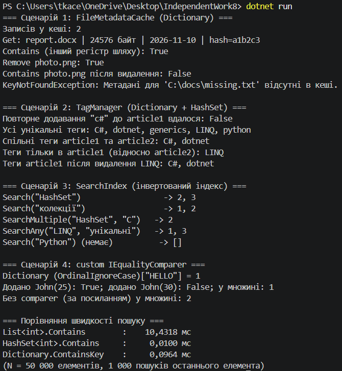

# Самостійна робота №14

**З дисципліни:** Об'єктно-орієнтоване програмування
**Тема:** `Dictionary<TKey, TValue>` та `HashSet<T>` у бібліотеках .NET
**Виконав:** студент Ткаченко Максим

---

## Опис

Консольний застосунок демонструє сценарії використання `Dictionary` та `HashSet`. Аналіз прикладів з open-source проєктів, порівняльна таблиця й висновки — у файлі [REPORT.md](REPORT.md).

## Структура проєкту

- `FileMetadata.cs`, `FileMetadataCache.cs` — **сценарій 1:** кеш метаданих файлів (`Dictionary<string, FileMetadata>`): `Add`, `Get`, `TryGet`, `Remove`, `Contains`.
- `TagManager.cs` — **сценарій 2:** унікальні теги (`Dictionary<string, HashSet<string>>`): `AddTag`, `RemoveTag`, `GetAllUniqueTags` (`UnionWith`), `FindCommonTags` (`IntersectWith`), `FindTagsOnlyInFirst` (`ExceptWith`).
- `SearchIndex.cs` — **сценарій 3 (додатковий):** інвертований індекс (`Dictionary<string, HashSet<int>>`): `AddDocument`, `Search`, `SearchMultiple`, `SearchAny`.
- `Person.cs` — клас `Person` та `PersonNameComparer : IEqualityComparer<Person>` (custom comparer).
- `Program.cs` — демонстрація всіх сценаріїв, custom comparer і порівняння швидкості пошуку `List` / `HashSet` / `Dictionary`.
- `REPORT.md` — звіт: приклади з open-source проєктів, таблиця, висновки.
- `.gitignore` — виключає службові файли .NET, VS Code та ОС.

## Запуск

```bash
dotnet run
```

## Приклад виводу програми


```
=== Сценарій 1: FileMetadataCache (Dictionary) ===
Записів у кеші: 2
Get: report.docx | 24576 байт | 2026-11-10 | hash=a1b2c3
Contains (інший регістр шляху): True
Remove photo.png: True
Contains photo.png після видалення: False
KeyNotFoundException: Метадані для 'C:\docs\missing.txt' відсутні в кеші.

=== Сценарій 2: TagManager (Dictionary + HashSet) ===
Повторне додавання "c#" до article1 вдалося: False
Усі унікальні теги: C#, dotnet, generics, LINQ, python
Спільні теги article1 та article2: C#, dotnet
Теги тільки в article1 (відносно article2): LINQ
Теги article1 після видалення LINQ: C#, dotnet

=== Сценарій 3: SearchIndex (інвертований індекс) ===
Search("HashSet")                  -> 2, 3
Search("колекції")                 -> 1, 2
SearchMultiple("HashSet", "C")   -> 2
SearchAny("LINQ", "унікальні")   -> 1, 3
Search("Python") (немає)          -> []

=== Сценарій 4: custom IEqualityComparer ===
Dictionary (OrdinalIgnoreCase)["HELLO"] = 1
Додано John(25): True; додано John(30): False; у множині: 1
Без comparer (за посиланням) у множині: 2

=== Порівняння швидкості пошуку ===
List<int>.Contains        :    10,4318 мс
HashSet<int>.Contains     :     0,0100 мс
Dictionary.ContainsKey    :     0,0964 мс
(N = 50 000 елементів, 1 000 пошуків останнього елемента)
```

### Скріншот

